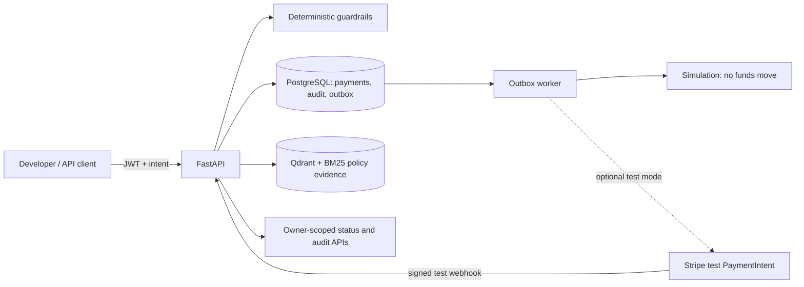

# One Intent, One Payment

A runnable, local proof of concept for authenticated, deterministic, idempotent payment intents. It uses FastAPI, PostgreSQL, Qdrant with BM25/RRF retrieval, a transactional outbox, and optional Stripe **test-mode** PaymentIntents.

> **Local demo only.** MPP and x402 are simulations. Stripe live mode is rejected. Local JWTs and file-backed secrets are development tools; do not expose this service publicly or use it for real payments.

## Get started

Requirements: Docker Desktop (or Docker Engine with Compose) and Python for the local secret initializer.

```powershell
python -m scripts.init_local_secrets
if (-not (Test-Path .env)) { Copy-Item .env.example .env }
docker compose up --build -d
Invoke-RestMethod http://localhost:8000/readyz
```

For the complete request walkthrough and demo commands, see the [project README](docs/README.md).

## Documentation

| Guide | Description |
|---|---|
| [Project README](docs/README.md) | Setup, lifecycle, endpoints, Stripe test mode, operations, and repository layout |
| [Architecture](docs/ARCHITECTURE.md) | C4-style system, container, component, and request-flow diagrams |
| [Use cases](docs/USE_CASES.md) | Actors, preconditions, main flows, and expected outcomes |
| [Testing strategy](docs/TEST_STRATEGY.md) | Unit, integration, functional, and regression coverage and commands |
| [Endpoint testing guide](docs/TESTING_GUIDE.md) | PowerShell scenarios for API endpoints, negative cases, Stripe, and outbox recovery |
| [Threat model](docs/THREAT_MODEL.md) | Trust boundaries, abuse cases, mitigations, and production gaps |

## At a glance



Retrieved policies provide evidence only. Authorization is enforced by deterministic code; it is not delegated to an LLM or retrieved text.

## Validate

Automated tests run in the Docker image:

```powershell
docker compose run --no-deps --rm `
  --volume "$($PWD.Path)\tests:/workspace/tests:ro" `
  api python -m unittest discover -s /workspace/tests -v
```

The test strategy distinguishes automated unit/API regression checks from manual end-to-end/functional scenarios and disposable-PostgreSQL integration checks. See [Testing strategy](docs/TEST_STRATEGY.md) and [Endpoint testing guide](docs/TESTING_GUIDE.md).

## Project status

The default provider is `simulation`. Optional Stripe test mode requires local `sk_test_` and Stripe CLI webhook secrets. The current authentication, secret storage, audit, and operations controls are PoC-grade; read the [threat model](docs/THREAT_MODEL.md) before extending deployment scope.
