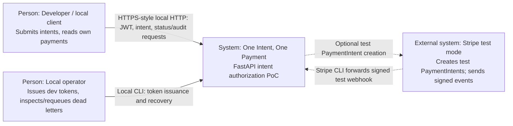
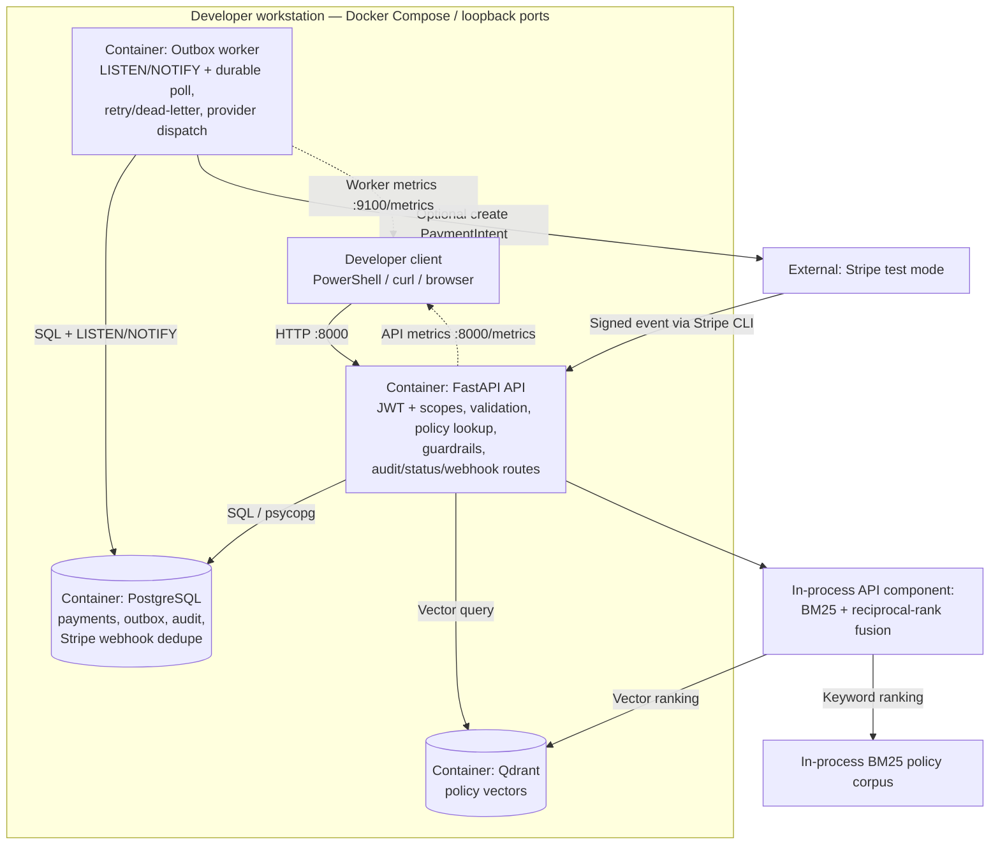
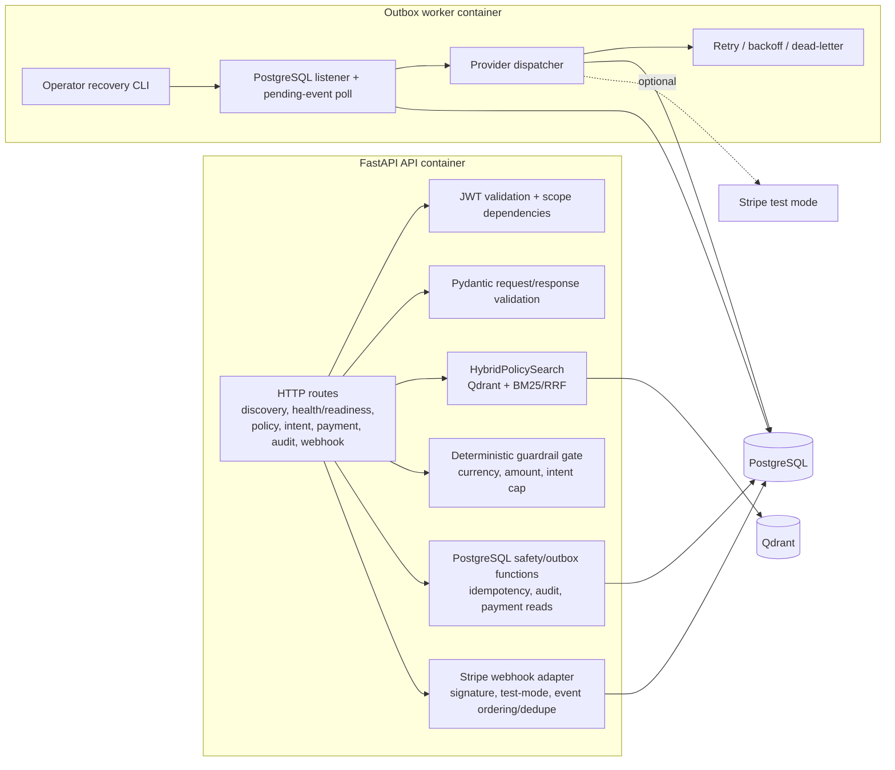
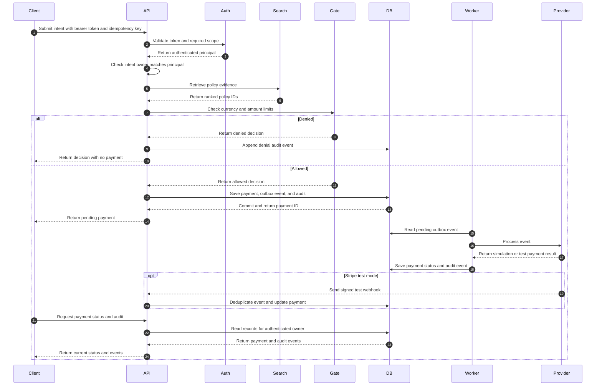

# Architecture

This document describes the local proof of concept as C4-style context, container, and component views, followed by its primary runtime sequence. The diagrams use Mermaid flowcharts and sequence diagrams so they render in GitHub and common Markdown viewers.

> These diagrams represent the current implementation. Stripe is optional and test-mode-only; the MPP/x402 adapters do not contact providers or move funds.

## C1 — System context

**Trust boundary:** the local machine and its Docker services are trusted. Host services are loopback-bound. The local JWT issuer is an operator utility, not a production identity provider. Stripe is not used in the default simulation flow.

## C2 — Containers

The in-process policy search combines Qdrant's ranked results with local BM25 rankings using reciprocal-rank fusion. This hybrid search retrieves policy evidence; the guardrail decision is made by deterministic Python code.

## C3 — API and worker components

## Runtime sequence — authorization to status

## Data and state boundaries

- **Payment write:** the API persists the payment row and outbox row atomically; PostgreSQL uniqueness and advisory locks enforce one matching payment per intent and idempotency key.
- **Asynchronous dispatch:** `pg_notify` is a wake-up signal. The outbox remains the durable source of work; the worker polls pending events even when a notification is missed.
- **Audit:** authorization outcomes and important payment transitions are appended to PostgreSQL. Database triggers reject audit row updates, deletes, and truncation, but a database owner can bypass these protections.
- **Payment ownership:** status and audit reads filter by the authenticated subject. Unknown and another-owner payment IDs both appear as not found from the status endpoint.
- **Stripe test mode:** only test keys and signed test events are accepted. The owner confirms the PaymentIntent client-side; card details must never pass through this API.
- **Policy search:** the Qdrant vectors use deterministic feature hashing, not semantic model embeddings. Retrieved text does not act as an authorization rule.

## HTTP route map

| Route | Responsibility | Authentication |
|---|---|---|
| `GET /` | Service metadata | Public |
| `GET /healthz` | Liveness | Public |
| `GET /readyz` | PostgreSQL and Qdrant readiness | Public |
| `GET /metrics` | API Prometheus metrics | Public; loopback-bound |
| `GET /.well-known/agent.json` | Agent capability card | Public |
| `GET /agent-cards` | Agent capability cards | Public |
| `GET /policies/search` | Hybrid policy evidence search | `policies:read` |
| `POST /intents/authorize` | Validate, decide, audit, persist, enqueue | `intents:write` and matching subject |
| `GET /payments/{payment_id}` | Payment status | `payments:read`, owner-filtered |
| `GET /intents/{intent_id}/audit` | Intent audit events | `payments:read`, subject-filtered |
| `GET /payments/{payment_id}/audit` | Payment audit events | `payments:read`, owner-filtered |
| `POST /webhooks/stripe` | Stripe test webhook | Stripe signature; hidden from OpenAPI |

Worker metrics are exposed separately at `http://127.0.0.1:9100/metrics`. Operator outbox inspection and requeue are local CLI operations rather than HTTP routes.
